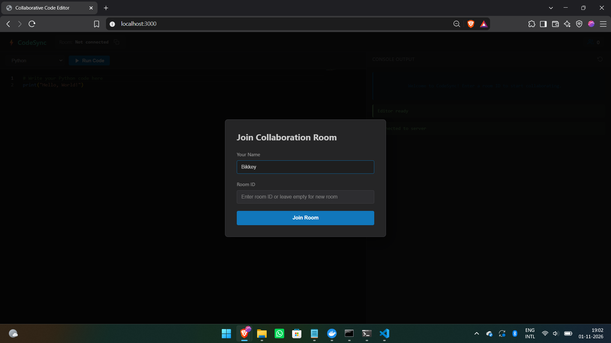
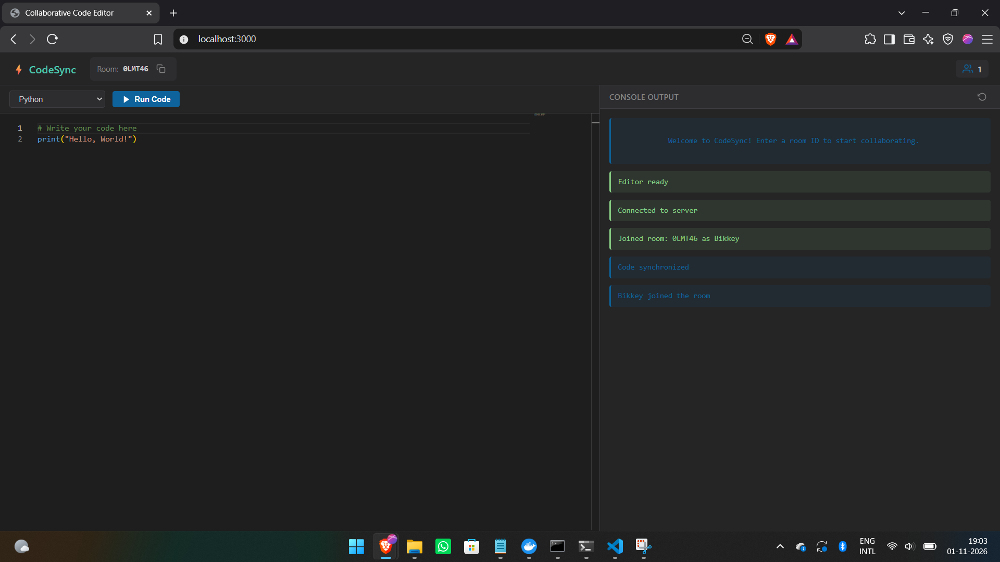
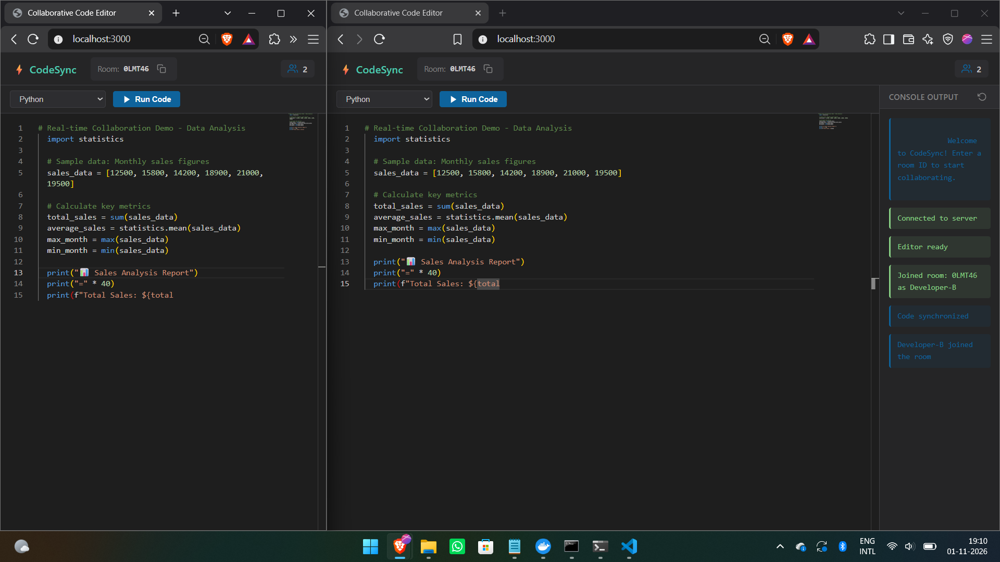
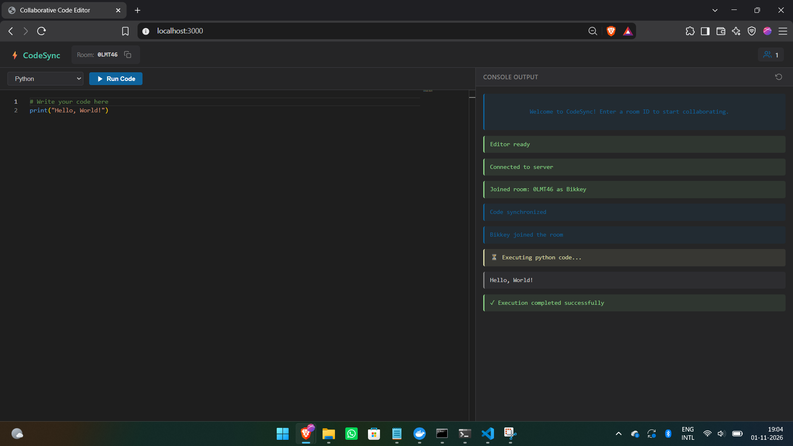
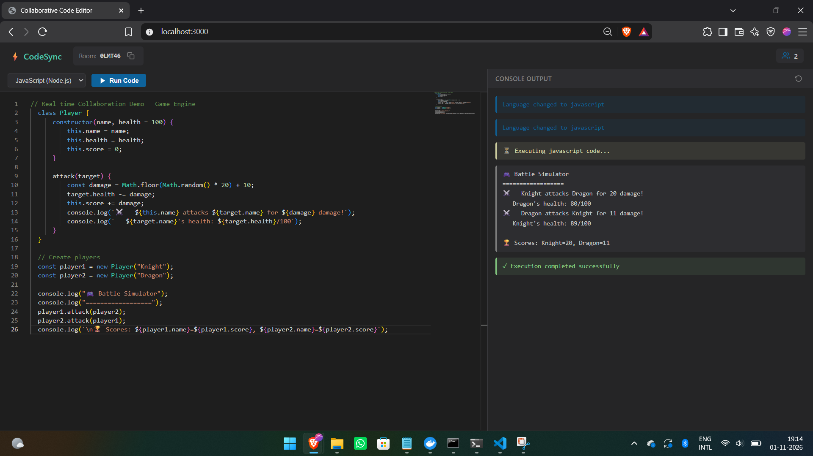

# 🚀 Real-Time Collaborative Code Editor with Docker Execution

[](https://nodejs.org/)
[](https://expressjs.com/)
[](https://socket.io/)
[](https://www.docker.com/)
[](https://microsoft.github.io/monaco-editor/)

A production-ready, real-time collaborative code editor with isolated Docker-based code execution. Think **Google Docs meets Replit** - multiple users can code together in real-time and execute code safely in sandboxed containers.

## 🎥 Demo

> **Live Collaboration Demo**: Open two browser tabs, join the same room, and watch code sync in real-time!

**Repository**: [github.com/bikkeyprasad19/Real-Time-Collaborative-Code-Sync-Execution-Engine](https://github.com/bikkeyprasad19/Real-Time-Collaborative-Code-Sync-Execution-Engine)

## 📸 Screenshots

### Join Collaboration Room
<p align="center">
  
</p>
<p align="center"><em>Simple room-based collaboration - enter your name and room ID to start coding together</em></p>

### Main Code Editor Interface
<p align="center">
  
</p>
<p align="center"><em>Monaco Editor with VS Code-like features and dark theme</em></p>

### Real-Time Collaboration
<p align="center">
  
</p>
<p align="center"><em>Multiple users editing simultaneously - changes sync instantly across all connected clients</em></p>

### Code Execution Examples

<p align="center">
  
</p>
<p align="center"><em>Python code execution with real-time output in sandboxed Docker containers</em></p>

<p align="center">
  
</p>
<p align="center"><em>JavaScript (Node.js) execution with instant feedback</em></p>

## ✨ Features

- **Real-Time Collaboration**: Multiple users can edit code simultaneously in shared rooms
- **Live Synchronization**: Instant code updates across all connected users using WebSockets
- **Isolated Code Execution**: Docker-based sandboxed execution for Python, JavaScript (Node.js), and C++
- **Security First**: Memory/CPU limits, network isolation, execution timeouts, and non-root containers
- **Modern Developer UI**: Dark-themed interface with Monaco Editor (VS Code's editor)
- **Room Management**: Simple room-based architecture with user presence indicators

## 🏗️ Architecture

```
project1/
├── client/                  # Frontend application
│   ├── index.html          # Main HTML structure
│   ├── styles.css          # Dark-themed UI styles
│   └── app.js              # Socket.io client & editor logic
├── server/                  # Backend Node.js application
│   ├── server.js           # Express + Socket.io server
│   └── services/
│       └── executionService.js  # Docker execution engine
├── docker/                  # Docker sandbox images
│   ├── python/
│   │   ├── Dockerfile
│   │   └── entrypoint.sh
│   ├── node/
│   │   ├── Dockerfile
│   │   └── entrypoint.sh
│   └── cpp/
│       ├── Dockerfile
│       └── entrypoint.sh
├── scripts/
│   └── build-docker-images.js  # Build automation script
├── package.json
└── README.md
```

## 🔧 Technology Stack

- **Backend**: Node.js, Express.js
- **Real-Time**: Socket.io (WebSockets)
- **Code Execution**: Docker + Dockerode SDK
- **Frontend**: HTML5, CSS3, JavaScript
- **Code Editor**: Monaco Editor
- **Styling**: Custom dark theme (VS Code inspired)

## 📋 Prerequisites

Before you begin, ensure you have the following installed:

1. **Node.js** (v16 or higher)
   - Download from: https://nodejs.org/
   - Verify: `node --version`

2. **Docker Desktop**
   - Download from: https://www.docker.com/products/docker-desktop/
   - Verify: `docker --version`
   - **Important**: Make sure Docker Desktop is running before proceeding

3. **Git** (optional, for version control)
   - Download from: https://git-scm.com/

## 🚀 Installation & Setup

### Step 1: Install Dependencies

Open PowerShell in the project directory and run:

```powershell
npm install
```

This will install all required Node.js packages:
- express
- socket.io
- dockerode
- uuid
- cors

### Step 2: Build Docker Images

Build the sandboxed execution containers for all supported languages:

```powershell
npm run build-images
```

This process will:
- Build Python execution container (code-executor-python)
- Build Node.js execution container (code-executor-node)
- Build C++ execution container (code-executor-cpp)

**Note**: This may take 5-10 minutes depending on your internet connection.

### Step 3: Verify Docker Images

Confirm all images were built successfully:

```powershell
docker images | Select-String "code-executor"
```

You should see three images:
- code-executor-python
- code-executor-node
- code-executor-cpp

### Step 4: Start the Server

Start the development server:

```powershell
npm start
```

You should see:
```
🚀 Server running on http://localhost:3000
📡 WebSocket server ready
🐳 Docker execution service initialized
```

### Step 5: Open in Browser

Navigate to:
```
http://localhost:3000
```

## 🎮 Usage Guide

### Starting a Collaboration Session

1. **Open the application** in your browser
2. **Enter your name** in the join modal
3. **Enter a room ID** (or leave empty to create a new room)
4. **Click "Join Room"**
5. **Share the room ID** with collaborators

### Real-Time Collaboration

- **Code together**: All connected users see changes in real-time
- **Switch languages**: Use the language dropdown (Python, JavaScript, C++)
- **User presence**: See how many users are in the room
- **Copy room ID**: Click the copy icon to share with others

### Executing Code

1. **Write or edit code** in the Monaco editor
2. **Click "Run Code"** or press `Ctrl+Enter` / `Cmd+Enter`
3. **View output** in the console panel on the right

### Language Support

#### Python
```python
# Example
print("Hello from Python!")
for i in range(5):
    print(f"Count: {i}")
```

#### JavaScript (Node.js)
```javascript
// Example
console.log("Hello from JavaScript!");
for (let i = 0; i < 5; i++) {
    console.log(`Count: ${i}`);
}
```

#### C++
```cpp
// Example
#include <iostream>
int main() {
    std::cout << "Hello from C++!" << std::endl;
    for (int i = 0; i < 5; i++) {
        std::cout << "Count: " << i << std::endl;
    }
    return 0;
}
```

## 🔒 Security Features

### Container Isolation
- **No network access**: Containers cannot make external network requests
- **Memory limit**: 128MB per execution
- **CPU limit**: 0.5 CPU cores
- **Process limit**: Maximum 50 processes
- **Execution timeout**: 5 seconds for Python/JS, 10 seconds for C++ (includes compilation)

### User Safety
- **Non-root execution**: Code runs as unprivileged user (UID 1000)
- **Read-only root filesystem**: Prevents system modifications
- **Auto-cleanup**: Containers are automatically removed after execution
- **Resource limits**: Prevents infinite loops and resource exhaustion

## 🐛 Troubleshooting

### Docker Image Not Found
```
Error: Docker image 'code-executor-python' not found
```
**Solution**: Run `npm run build-images`

### Docker Daemon Not Running
```
Error: connect ENOENT //./pipe/docker_engine
```
**Solution**: Start Docker Desktop and wait for it to fully initialize

### Port Already in Use
```
Error: listen EADDRINUSE: address already in use :::3000
```
**Solution**: Either:
- Stop the process using port 3000, or
- Change the port in server.js: `const PORT = process.env.PORT || 3001;`

### Connection Timeout
If code execution times out:
- Check if Docker Desktop is running
- Verify containers can be created: `docker ps -a`
- Check Docker logs: `docker logs <container-id>`

## 🔧 Configuration

### Changing Execution Limits

Edit `server/services/executionService.js`:

```javascript
const RESOURCE_LIMITS = {
  Memory: 256 * 1024 * 1024, // Change to 256MB
  NanoCpus: 1000000000,       // Change to 1 CPU
  PidsLimit: 100               // Change to 100 processes
};

// Timeout per language
const LANGUAGE_CONFIGS = {
  python: {
    timeout: 10000  // Change to 10 seconds
  }
};
```

### Changing Server Port

Edit `server/server.js`:

```javascript
const PORT = process.env.PORT || 4000; // Change to 4000
```

Or use environment variable:
```powershell
$env:PORT=4000; npm start
```

## 📊 API Endpoints

### POST /api/execute
Execute code in a Docker container

**Request:**
```json
{
  "code": "print('Hello')",
  "language": "python"
}
```

**Response:**
```json
{
  "success": true,
  "stdout": "Hello\n",
  "stderr": "",
  "exitCode": 0
}
```

### GET /api/health
Health check endpoint

**Response:**
```json
{
  "status": "ok",
  "timestamp": "2026-10-29T18:30:00.000Z",
  "activeRooms": 3
}
```

## 🧪 Testing

### Test Python Execution
```python
import sys
print(f"Python version: {sys.version}")
print("Hello, World!")
```

### Test JavaScript Execution
```javascript
console.log(`Node version: ${process.version}`);
console.log("Hello, World!");
```

### Test C++ Execution
```cpp
#include <iostream>
int main() {
    std::cout << "C++ compiler works!" << std::endl;
    return 0;
}
```

## 🚀 Production Deployment

### Environment Variables
```bash
PORT=3000
NODE_ENV=production
```

### Build for Production
```powershell
npm install --production
npm run build-images
npm start
```

### Recommended Hosting
- **Backend**: AWS EC2, DigitalOcean, Heroku
- **Docker**: Ensure Docker is installed on the host
- **WebSocket**: Configure reverse proxy (Nginx) for Socket.io

### Nginx Configuration Example
```nginx
server {
    listen 80;
    server_name your-domain.com;

    location / {
        proxy_pass http://localhost:3000;
        proxy_http_version 1.1;
        proxy_set_header Upgrade $http_upgrade;
        proxy_set_header Connection "upgrade";
        proxy_set_header Host $host;
    }
}
```

## 📈 Performance Considerations

- **Room cleanup**: Empty rooms are deleted after 5 minutes of inactivity
- **Container cleanup**: Containers auto-remove after execution
- **Memory usage**: ~30-50MB per active user + execution overhead
- **Concurrent execution**: Limited by host Docker resources

## 🛡️ Known Limitations

1. **Windows Docker**: Docker execution works but is slower than Linux
2. **Large outputs**: Outputs over 10MB may cause performance issues
3. **File I/O**: Limited to in-memory operations only
4. **Package installation**: Pre-installed packages only (no pip/npm install)

## 📚 Future Enhancements

- [ ] File upload/download support
- [ ] Code persistence (database storage)
- [ ] More language support (Rust, Go, Java)
- [ ] Syntax error highlighting
- [ ] Code sharing via shareable links
- [ ] User authentication
- [ ] Private rooms with passwords
- [ ] Code execution history

## 📝 License

MIT License - feel free to use this project for learning or commercial purposes.

## 🤝 Contributing

Contributions are welcome! Please feel free to submit issues or pull requests.

## 📧 Support

If you encounter issues:
1. Check the troubleshooting section
2. Review Docker and Node.js logs
3. Ensure all prerequisites are installed
4. Verify Docker Desktop is running

---

**Built with ❤️ for collaborative coding**
